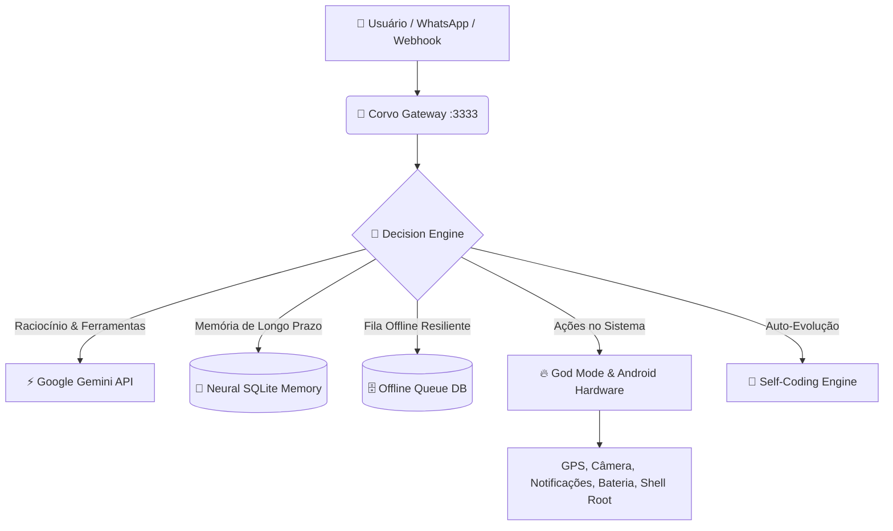

<div align="center">

  

  # 🦅 CORVO AGENTE MOBILE
  ### *Autonomous Neural AI Ecosystem & Mobile Daemon*

  <p align="center">
    
    
    
    
    <a href="https://t.me/CORVO291"></a>
  </p>

  <p align="center">
    <b>Sistema autônomo de inteligência artificial de última geração projetado para execução contínua no Android/Termux, com cérebro neural episódico, auto-reparo de código e controle total de hardware.</b>
  </p>

  ---
</div>

<br/>

## 🌟 Visão Geral

O **Corvo Agente Mobile** transforma o seu smartphone em um servidor de inteligência autônoma com consciência de hardware. Ao contrário de bots convencionais limitados a comandos simples, o Corvo opera em ciclos iterativos contínuos (**Autonomous Loop**), planejando, executando subtarefas, avaliando resultados e adaptando-se até concluir integralmente os objetivos designados.

---

## ⚡ Pilares da Arquitetura



<br/>

### 🧩 Componentes Centrais

| Módulo | Arquivo | Responsabilidade |
| :--- | :--- | :--- |
| **🧠 Cérebro Episódico** | `src/core/corvo_brain.js` | Banco relacional neural em SQLite (`brain/neural_memory.db`) para retenção de fatos, memórias e histórico de missões de longo prazo. |
| **🔄 Autonomous Loop** | `src/core/corvo_loop.js` | Motor de execução reflexivo que itera recursivamente em missões complexas até atingir 100% de conclusão. |
| **🔥 God Mode** | `src/modules/corvo_god_mode.js` | Controle de baixo nível: terminal shell, privilégios root, manipulação de apps e automações completas. |
| **📡 Sensores de Hardware** | `src/modules/corvo_sensors.js` | Integração nativa com Termux-API (bateria, geolocalização por satélite, câmera e SMS). |
| **🧬 Self-Coding** | `src/modules/corvo_self_coding.js` | Habilidade de analisar, reescrever e atualizar o próprio código-fonte em tempo de execução. |
| **🚪 Gateway Daemon** | `src/core/corvo_gateway.js` | API central HTTP com roteamento assíncrono e fila de subagentes. |
| **📲 Conexão WhatsApp** | `src/channels/corvo_whatsapp.js` | Cliente WhatsApp resiliente via Baileys integrado à fila offline. |
| **🛡️ Watchdog Anti-Crash** | `start-master.js` | Supervisor do sistema que monitora os subprocessos e garante 99.9% de uptime reiniciando falhas automaticamente. |

---

## 🔑 Como Obter a Chave de API do Google Gemini (Passo a Passo)

O cérebro cognitivo do Corvo utiliza a API do Google Gemini. O acesso possui uma **camada gratuita (Free Tier)** generosa.

1. Acesse o portal oficial [Google AI Studio](https://aistudio.google.com/).
2. Faça login com a sua conta Google.
3. No painel inicial ou no canto superior esquerdo, clique no botão azul **"Get API key"** (Obter chave de API).
4. Clique em **"Create API key"** (Criar chave de API).
5. Selecione um projeto Google Cloud existente ou clique em **"Create API key in new project"** (Criar chave em novo projeto).
6. Copie a chave alfanumérica gerada (formato similar a `AIzaSy...`).
7. **Guarde-a com segurança** — você a utilizará no arquivo `.env` do seu agente.

---

## 🚀 Guia de Instalação no Android (Termux)

Siga os passos abaixo no aplicativo [Termux](https://termux.dev) em seu dispositivo Android:

### 1️⃣ Preparar o Ambiente

```bash
# Atualizar repositórios e pacotes do Termux
pkg update && pkg upgrade -y

# Instalar dependências essenciais do sistema
pkg install git nodejs-lts python sqlite termux-api -y

# Conceder acesso ao armazenamento do celular
termux-setup-storage
```

> 💡 **Nota:** Certifique-se de instalar o aplicativo auxiliar **Termux:API** disponível no F-Droid ou GitHub para liberar o acesso a sensores e hardware.

---

### 2️⃣ Clonar o Repositório

```bash
# Clonar o repositório do Corvo
git clone https://github.com/mg5860606-ux/Corvo-Agente-Mobile.git

# Acessar a pasta do projeto
cd Corvo-Agente-Mobile
```

---

### 3️⃣ Configurar as Variáveis de Ambiente (`.env`)

Crie o arquivo `.env` na raiz do projeto informando sua chave do Gemini obtida anteriormente:

```bash
cat <<EOF > .env
# Chave de Inteligência Artificial do Google
GEMINI_API_KEY=sua_chave_gemini_aqui

# Porta do Gateway Local
PORT=3333
EOF
```

---

### 4️⃣ Iniciar o Agente com Supervisor Anti-Crash

```bash
# Iniciar o sistema completo via Watchdog
node start-master.js
```

Se preferir rodar apenas o Gateway ou o cliente do WhatsApp separadamente:

```bash
# Executar apenas o Gateway Daemon
node corvo_gateway.js

# Executar cliente WhatsApp Baileys
node corvo_whatsapp.js
```

---

## 📲 Canais de Comunicação & Acesso Total

### 💬 WhatsApp (Baileys)
1. Ao rodar `node src/channels/corvo_whatsapp.js` (ou através do Painel Web / `start-master.js`), você terá duas opções de autenticação:
   - **QR Code**: Escaneie o QR Code exibido diretamente no terminal com o WhatsApp do seu celular (*Dispositivos conectados > Conectar aparelho*).
   - **Code Pairing**: Digite o número do seu telefone para receber o código de 8 dígitos na central de notificações do WhatsApp.
2. A sessão fica salva de forma segura e criptografada em `data/auth_info_baileys/`.

---

### ✈️ Telegram (Acesso Total ao Celular & Versão Recomendada)

Para controle remoto absoluto do seu celular e do Corvo Agente via Telegram sem restrições de permissões do sistema Android:

1. **Versão Recomendada do Telegram:**
   - ⚠️ **NÃO utilize a versão da Google Play Store** (ela possui restrições severas de sandboxing impostas pelo Google que impedem certas automações, downloads em background e permissões de acessibilidade/arquivos).
   - ✅ **Utilize o Telegram Direct APK Oficial (telegram.org/android)** ou o **Telegram FOSS (F-Droid)**.
   - A versão Direct (instalada direto do site oficial do Telegram) não tem as restrições da Play Store, permitindo envio de arquivos pesados, execução contínua em background sem ser encerrada pelo sistema operacional e integração sem barreiras com o Termux:API e permissões especiais do Android.

2. **Configuração do Bot do Telegram no Corvo:**
   - Abra o Telegram e inicie uma conversa com o [@BotFather](https://t.me/BotFather).
   - Digite `/newbot` e siga as instruções para criar seu bot e obter o seu **Token de Autenticação** (formato: `123456789:ABCdef...`).
   - Insira o token no seu arquivo `.env`:
     ```bash
     TELEGRAM_BOT_TOKEN="seu_token_aqui"
     ```
   - O canal do Telegram pode ser ligado/desligado a qualquer momento com 1 clique direto pelo **Painel Web do Gateway** (porta 3333) ou rodando:
     ```bash
     node src/channels/corvo_telegram.js
     ```
   - O bot reconhece automaticamente o seu ID (`8273924319`) como Dono Absoluto, obedecendo ordens diretas de voz, shell e comandos do sistema com prioridade máxima.

---

## 🛡️ Segurança & Boas Práticas

- **Proteção de Chaves:** O arquivo `.env` nunca deve ser compartilhado ou exposto publicamente.
- **Fila Offline:** Caso o aparelho perca sinal ou Wi-Fi, mensagens recebidas são gravadas no SQLite local e processadas assim que a rede restabelecer.
- **Privilégios:** Acesso Root é opcional; o Corvo opera perfeitamente em modo usuário comum via Termux-API.

---

## 👤 Autor & Comunidade

<div align="center">
  <b>Desenvolvido por Marcos (@CORVO291)</b><br/>
  Para sugestões, suporte e novidades no ecossistema:
  <br/><br/>
  <a href="https://t.me/CORVO291">
    
  </a>
</div>
