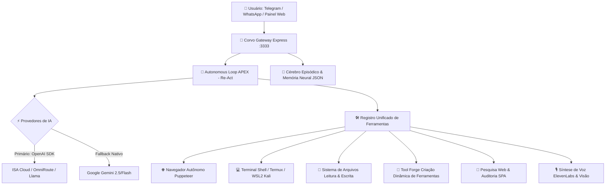

<div align="center">

  

  # 🦅 CORVO AGENTE MOBILE v2.0
  ### *Autonomous Neural AI Ecosystem, Re-Act Loop & Mobile Sovereign Hub*

  <p align="center">
    
    
    
    
    <a href="https://t.me/CORVO291"></a>
  </p>

  <p align="center">
    <b>Sistema autônomo de inteligência artificial de última geração projetado para execução contínua no Android/Termux e Desktop, com cérebro neural episódico, loop autônomo Re-Act com ferramentas reais, navegador headless, síntese de voz, canais integrados (Telegram & WhatsApp) e painel web soberano.</b>
  </p>

  ---
</div>

<br/>

## 🌟 Visão Geral

O **Corvo Agente Mobile v2.0** opera como um agente neural autônomo com consciência de hardware e ambiente. Diferente de bots comuns de comando/resposta, o Corvo opera em ciclos iterativos (**Autonomous Loop Re-Act**): ele planeja a solução, aciona ferramentas reais (terminal, arquivos, navegador web, automação, visão, scanner de rede), analisa o retorno e só encerra a missão quando comprovar o resultado com sucesso.

---

## ⚡ Arquitetura Atual



<br/>

### 🧩 Componentes Centrais

| Componente | Arquivo | Responsabilidade |
| :--- | :--- | :--- |
| **🔄 Autonomous Loop** | [`src/core/corvo_loop.js`](file:///c:/Corvo-Agente-Mobile/src/core/corvo_loop.js) | Motor Re-Act recursivo de resolução de problemas e execução autônoma de missões. |
| **🧠 Cérebro Episódico** | [`src/core/corvo_brain.js`](file:///c:/Corvo-Agente-Mobile/src/core/corvo_brain.js) | Memória episódica com busca semântica (BM25/TF-IDF), histórico de missões, telemetria e persistência atômica segura. |
| **🛠️ Arsenal de Ferramentas** | [`src/core/corvo_tools_registry.js`](file:///c:/Corvo-Agente-Mobile/src/core/corvo_tools_registry.js) | Execução de shell/Termux/Kali, navegador, leitura/escrita de arquivos, prints e criação dinâmica de novas ferramentas (`create_custom_tool`). |
| **🌐 Navegador Autônomo** | [`src/modules/corvo_browser.js`](file:///c:/Corvo-Agente-Mobile/src/modules/corvo_browser.js) | Automação web real com Puppeteer (navegação, cliques, digitação, prints de tela e downloads). |
| **🚪 Gateway & Painel Web** | [`src/core/corvo_gateway.js`](file:///c:/Corvo-Agente-Mobile/src/core/corvo_gateway.js) | Servidor HTTP com UI completa, histórico ao vivo, envio de áudios, imagens, controle de canais e execução de missões. |
| **✈️ Canal Telegram** | [`src/channels/corvo_telegram.js`](file:///c:/Corvo-Agente-Mobile/src/channels/corvo_telegram.js) | Bot completo via polling com transcrição de áudio, geração de voz, envio de mídias e modo autônomo. |
| **💬 Canal WhatsApp** | [`src/channels/corvo_whatsapp.js`](file:///c:/Corvo-Agente-Mobile/src/channels/corvo_whatsapp.js) | Conexão multi-device via Baileys com suporte a QR Code / Pairing Code e persistência na pasta `data/`. |
| **🎙️ Engine de Voz** | [`src/core/corvo_voice.js`](file:///c:/Corvo-Agente-Mobile/src/core/corvo_voice.js) | Síntese de voz com ElevenLabs e geração de áudios para Telegram e WhatsApp. |
| **🗄️ Persistência Mobile** | [`src/core/corvo_db.js`](file:///c:/Corvo-Agente-Mobile/src/core/corvo_db.js) | Gerenciador de fila e estado persistente 100% JavaScript (sem travas de compilação C++ no Android). |
| **🚀 Master Runner** | [`start-master.js`](file:///c:/Corvo-Agente-Mobile/start-master.js) | Inicializador simples dos serviços essenciais (Gateway + Telegram). |

---

## 🛠️ Arsenal de Ferramentas Disponíveis ao Agente

O Corvo conta com ferramentas reais prontas para uso no Autonomous Loop:

1. **`browser_navigate` / `browser_click` / `browser_type` / `browser_screenshot`**: Navegação web autônoma completa em sites reais.
2. **`exec_shell`**: Execução de comandos no terminal (Termux, Bash, PowerShell e Kali Linux via WSL2).
3. **`read_file` / `write_file`**: Leitura, inspeção e criação/modificação de código e arquivos.
4. **`web_search`**: Busca de informações ao vivo na internet via DuckDuckGo.
5. **`recon_scan`**: Varreduras de portas e serviços de rede (Nmap e HTTPX).
6. **`spa_auditor`**: Reconhecimento e auditoria de aplicações web e rotas.
7. **`screen_capture`**: Captura de tela do dispositivo para análise multimodal.
8. **`create_custom_tool` (Tool Forge)**: Capacidade de criar, compilar e registrar novas funções em JavaScript em tempo real durante a execução caso precise de uma ferramenta inexistente.

---

## ⚙️ Pré-requisitos & Configuração (`.env`)

Crie o arquivo `.env` na raiz do projeto baseado no `.env.example`:

```bash
cp .env.example .env
```

Edite as configurações desejadas:

```env
# Provedor de IA Principal (Compatível com OpenAI API / ISA Cloud / OmniRoute)
OPENAI_BASE_URL=http://127.0.0.1:20129/v1
OPENAI_API_KEY=sua_chave_aqui
PRIMARY_MODEL=isacloud/gemini-3.8-flash-high

# Provedor Fallback (Google Gemini)
GEMINI_API_KEY=sua_chave_gemini_aqui

# Gateway HTTP e Painel Web
PORT=3333
GATEWAY_AUTH_TOKEN=seu_token_opcional_de_protecao

# Telegram (Opcional)
TELEGRAM_BOT_TOKEN=seu_token_do_botfather

# Síntese de Voz (Opcional)
ELEVENLABS_API_KEY=sua_chave_elevenlabs
ELEVENLABS_VOICE_ID=EXAVITQu4vr4xnSDxMaL
```

---

## 🚀 Como Executar

### 1. Iniciar Tudo de Uma Vez
Inicia o Gateway na porta configurada e o bot do Telegram:
```bash
npm start
# ou: node start-master.js
```

### 2. Iniciar Serviços Individualmente
```bash
# Gateway HTTP & Painel Web (http://localhost:3333)
npm run gateway

# Bot do Telegram
npm run telegram

# Bot do WhatsApp (Baileys)
npm run whatsapp

# Rodar a bateria de testes de validação
npm test
```

---

## 📲 Canais de Comunicação

### ✈️ Telegram
1. Obtenha o token do seu bot com o [@BotFather](https://t.me/BotFather).
2. Configure `TELEGRAM_BOT_TOKEN` no `.env`.
3. Inicie com `npm run telegram` ou via `start-master.js`.
4. O bot responde comandos diretos, mensagens de texto, recebe áudios e executa o Autonomous Loop quando acionado.

### 💬 WhatsApp (Baileys)
1. Inicie com `npm run whatsapp` ou ative pelo Painel Web.
2. Escaneie o QR Code no terminal ou use o fluxo de Pairing Code.
3. A sessão é armazenada de forma segura na pasta `data/auth_info_baileys/`.

---

## 👤 Autor

Desenvolvido por **Marcos (@CORVO291)**  
Canal Telegram Oficial: [@CORVO291](https://t.me/CORVO291)
